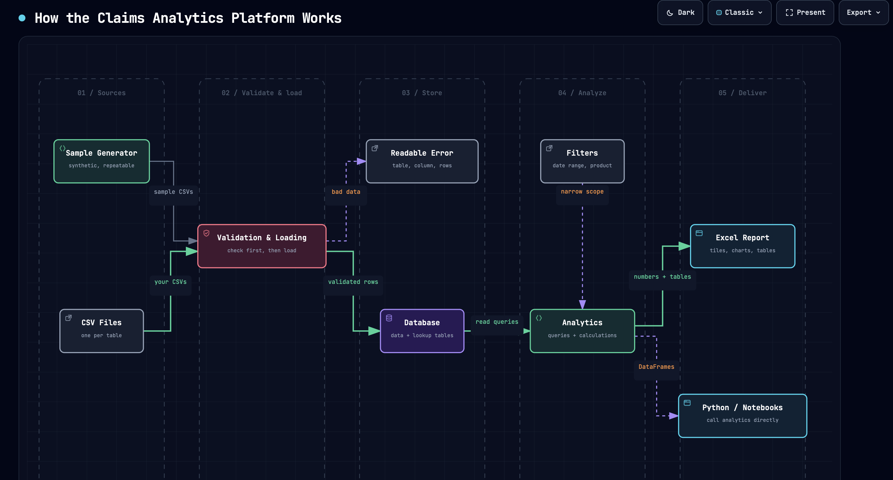
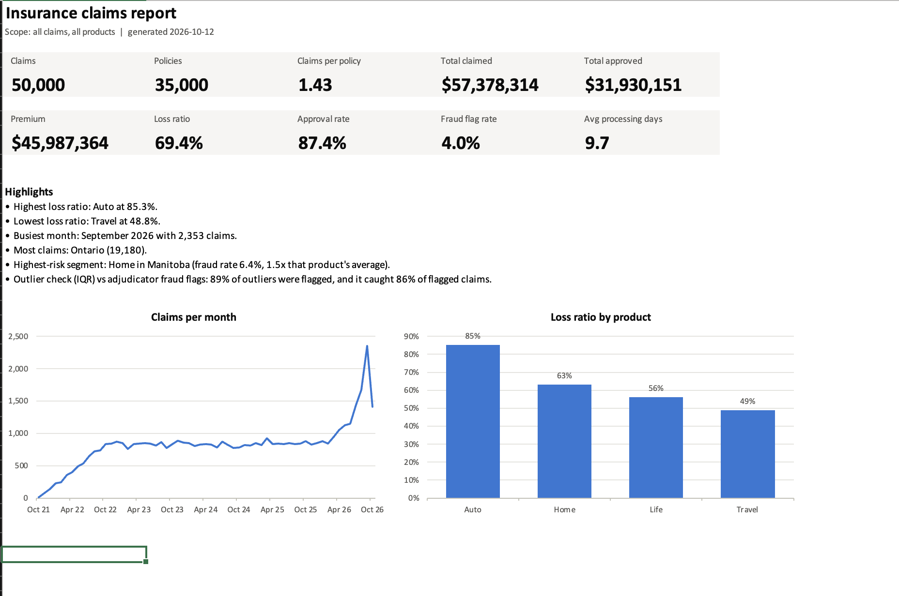
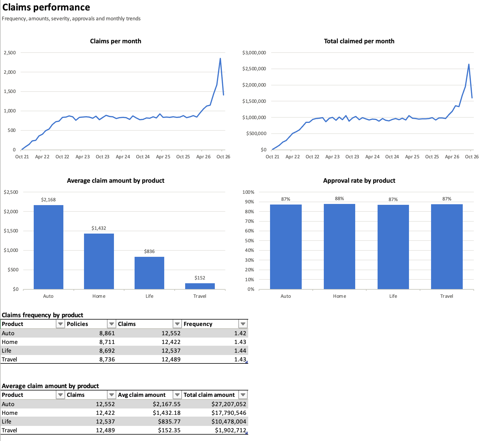
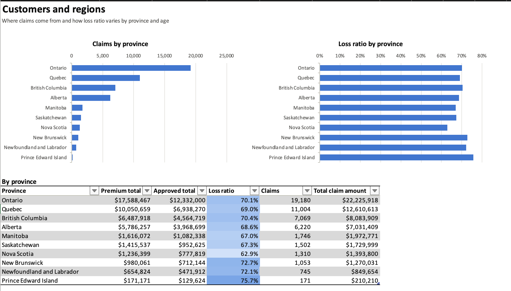

# Insurance Claims Analytics Platform

I built this to show a way to take messy operational insurance data and turn it into answers a business can use. As usual, there's no real customer data in here. Everything is synthetic, generated to look like a Canadian insurer with home, auto, life and travel policies. But the questions it answers are the ones a real claims team asks. After analysis, presents a summary report with key claims data measures.
All this is based on my own experience since I am not an insurer, adjuster or adjudicator.

## Problem Identified

Insurance Companies keep policies, claims, payments and adjudicator records (among many other data points) in different places, and usually there is not a single point that can answer simple questions without a week of spreadsheet work:

- Which insurance products lose money due to claims?
- How fast are claims actually being processed and decided?
- Are some claims suspicious or definitely fraudulent?
- Which customers and regions drive the losses?
- Which adjudicator has the most workload?

## My personal solution

A small end-to-end platform. To do this, I generates realistic data based on public schemas, check the data, loads it into PostgreSQL, runs the created analysis, and generate an Excel report with the answers and charts. This time, there is no front end (yet). Ideal would be to generate the resultant data into a PowerBI report or such.

On the sample data, for example, it shows Auto is the weakest line (85% of premium goes back out in claims, against 49% for Travel), and that a simple "unusually large claim" check finds about 85% of the claims adjudicators flagged as fraud.

## Architecture

```
generate data  ->  validate  ->  load into PostgreSQL  ->  analytics queries  ->  Excel report
(Faker, Python)    (pandera)     (bulk COPY, Docker)       (SQLAlchemy + pandas)  (XlsxWriter)
```



*How the platform fits together.* [Open the interactive version](https://pacordev.github.io/insurance_claims_analysis/docs/platform_overview.html) (pan, zoom, search, light and dark themes).

The project is split in two on purpose:

- `data/` creates and loads data: the schema, the generator, the loading pipeline.
- `app/` analyses it: the queries and the report.

The analytics queries are written with SQLAlchemy Core rather than Postgres-specific SQL, so they're not tied to one database. They run on SQLite in the tests and on PostgreSQL for real.

## Screenshots

Three of the seven sheets in the Excel report, built from the sample data.

**Overview**: headline numbers, a few auto-written highlights, and two charts.



**Claims performance**: monthly trends, average claim and approval rate by product, with the tables underneath (every table has filter buttons).



**Customers and regions**: claims and loss ratio by province, with the loss-ratio column shaded darker as it goes up.



The other four sheets are Financial, Risk & Fraud, Adjudicators and Notes.

## Features

- **Synthetic data**: four products, 20,000 customers, 35,000 policies, 50,000 claims, about 80,000 payments and 60 adjudicators, all Canadian (provinces, cities, postal codes). Reproducible, since the generator uses a fixed seed.
- **Validated loading**: every table is checked against the same rules as the database (allowed values, dates in order, approved amount never above claimed). Bad rows fail loudly with a readable error before they reach Postgres.
- **Claims analytics**: frequency, average claim and severity, approval rates, monthly trends, loss ratio, profitability, payout trends.
- **Fraud and risk**: fraud flag rates, outlier detection (IQR or z-score), how well the outlier check agrees with real fraud flags, and the riskiest product and province combinations.
- **Adjudicator performance**: real workload counted from claims, processing time, approval and fraud rates, by person and by seniority.
- **Regional and customer views**: claims and loss ratio by province and city, claims per customer by age band.
- **Excel report**: 7 sheets and 16 native charts, filterable by date range and product.

## Technology

Python 3.14, PostgreSQL 16 (in Docker), pandas, SQLAlchemy Core, pandera, psycopg2, Faker, XlsxWriter, pytest.

## Usage

You use the platform from the command line, and the one command you'll run most is the report.

**First time:**

```bash
python -m venv .venv
source .venv/bin/activate                                 # Windows: .venv\Scripts\activate
pip install -r requirements.txt
cp .env.example .env                                      # Windows: copy .env.example .env
docker compose up -d                                      # Postgres on port 5433, schema applied automatically
python data/datasets/claims_data_generator_v2.py          # makes the sample data (or use your own, see below)
python -m data.pipeline.cli --data-dir data/datasets      # loads it; add --fresh to wipe the tables first
```

**Then, every time you want the analysis:**

Open a terminal in the project folder, activate the virtual environment again (`source .venv/bin/activate`, it only stays active for that terminal), make sure Postgres is running (`docker compose up -d` does nothing if it already is), and run:

```bash
python -m app.reports.gen_excel_report
```

That runs all the analytics and writes `summary_reports/claims_report.xlsx`. To narrow it down:

```bash
python -m app.reports.gen_excel_report --date-from 2026-01-01 --product Auto --output summary_reports/auto_2026.xlsx
```

Options: `--date-from` and `--date-to` (YYYY-MM-DD), `--product` (any product in your data), `--output`. One thing to know: date filters only apply to claims. Premium always covers the full policy book, so loss ratio isn't meaningful for a partial date range.

Run all commands from the project folder (the one with `app/` and `data/` in it), otherwise Python can't find the modules.

**If it stops with an error**, it says what to do. The usual ones:

| You see | What it means |
|---|---|
| `can't connect to the database` | Postgres isn't running. Run `docker compose up -d`, and check `DATABASE_URL` in `.env`. |
| `the database is running but has no tables yet` | The schema was never applied. `docker compose down -v && docker compose up -d` starts it fresh. |
| `no claims are loaded yet` | Run the loader (the last command under "First time"). |

## Using your own data

The sample data is just CSV files, and you can swap in your own. The pipeline loads whatever is in the folder you point it at.

1. Copy the header-only files from `data/templates/` into a new folder, say `my_data/`, and fill them in. There are eight, one per table: `ref_line_of_business`, `products`, `ref_cause_of_loss`, `customers`, `adjudicators`, `policies`, `claims`, `payments`. All eight have to be there, even if one stays empty.
2. Load them: `python -m data.pipeline.cli --data-dir my_data --fresh` (that wipes whatever is in the tables first).
3. Build the report as usual.

A few things to know before you start:

- **Products are yours to define.** There's no fixed list. Each product in `products.csv` needs a line of business that's listed in `ref_line_of_business.csv`, and each cause of loss a claim can have is a row in `ref_cause_of_loss.csv`, tied to its product. The files `data/datasets/ref_*.csv` (made by the sample data generator) show the format. To add a "Pet" product: a row in `products.csv`, a line in `ref_line_of_business.csv` if it's new, and its causes in `ref_cause_of_loss.csv`. No code changes.
- **A claim's `claim_type` is a product name**, and its cause has to be one of that product's causes. Two more rules are checked: `claim_type` has to be the product of the claim's policy, and `claim_date` has to fall inside the policy's start and end dates (both days included). Claims that break any of these are rejected, and the database enforces them too.
- **Columns must match the templates.** A missing or extra column stops the load. Order doesn't matter.
- **`created_at` and `updated_at` are optional.** Leave them out and the loader fills in the current time.
- **Dates** are `2025-06-01` style, booleans are `True` / `False`, and an empty cell means no value.
- **A few columns still only accept fixed values.** Claim status is Pending, Approved, Denied or Closed. Policy status is Active, Expired or Cancelled. Payment method is EFT, Cheque or Credit. The full lists are in `data/pipeline/schemas.py`.
- **IDs have to line up.** Every policy needs a customer and product that exist, every claim a policy, every payment a claim. `approved_amount` can't be more than `claim_amount`.
- **Bad rows fail loudly**, with the table, column and rows listed. Tables load in order, so if `claims.csv` fails, the earlier tables stay loaded. Fix the file and rerun with `--fresh`.
- **Loading needs PostgreSQL.** The analytics don't care which database, but the loader uses Postgres bulk copy. If you use your own Postgres instead of Docker, apply `data/database/claims_schema_tables_v3.sql` first and set `DATABASE_URL` in `.env`.
- **The report handles any number of products.** Charts that draw one line per product show the four biggest by premium, with the rest added together as "Other".

## Testing

```bash
pytest
```

About 105 tests. The analytics and report tests run on a tiny in-memory SQLite database with hand-made data, so the right answers are known. The loading test runs against a separate `ins_claims_test` Postgres database that's created on the fly, so running the tests never touches your real data.

## Deployment

Local only for now: Docker for Postgres, everything else runs from the command line. There's no hosted version.

## Future improvements

- Make premium respect date filters, so loss ratio is right for partial periods.
- More realistic data: fewer claims per policy (currently about 1.4, high for real insurance), and built-in differences between adjudicators, regions and seasons so those reports have more to show.
- A FastAPI service exposing the analytics and basic read endpoints (for analytics tools to connect and consume).
- A live dashboard on top of the API, if the report turns out not to be enough.

## More detail

See [docs/TECHNICAL.md](docs/TECHNICAL.md) for the schema, the data generation logic, how the analytics work (including calling them from Python) and why some design choices were made.
